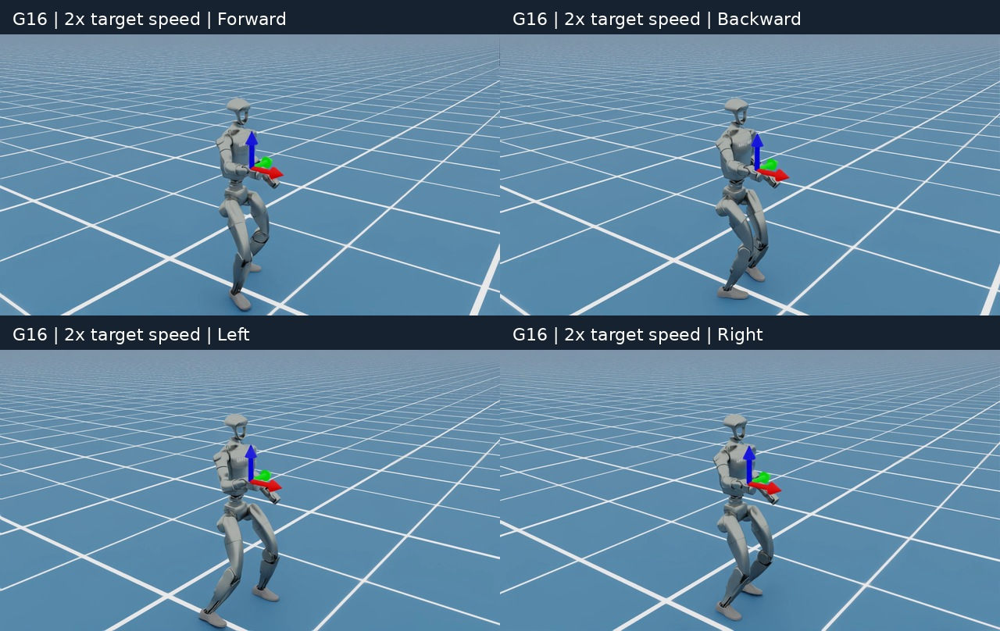
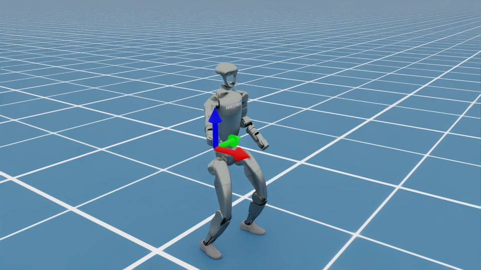

# G16 baseline — integration and translation speed evaluation

[Progress summary](../../REPORT.md) · [中文版](2026-11-19_g16_baseline_zh.md)

Date: **2026-11-19**

**Status: all four requested speed trials completed, including their final holds; videos verified.** This is the current reference baseline for future learning experiments; no new policy was trained in this evaluation.

The body-placement planner derives base XY/yaw and velocity commands from the wrist target and a preferred arm posture. Frozen **G16** follows those velocity commands using 12 leg joints and waist roll/pitch. Seven-joint right-arm IK tracks the world-frame wrist pose and compensates for measured body motion. G16 itself does not receive the wrist trajectory or choose the standing position.

The G16 deployment adapter preserves the model's joint ordering, observation history, gait clock, quaternion convention, and action scaling. It matched the supplied deployment runner exactly across 200 inference steps; 30 existing CPU tests and two adapter tests passed. The wrist planner, IK parameters, and base command limits were unchanged for the policy comparison.

*Frames from the G16 2× recording, in movement order. The RGB target axes indicate desired wrist pose: red +X, green +Y, blue +Z. These are external observer views, not footage from a wrist-mounted camera.*

## Evaluation setup

- One simulated G1, seed 42; 50 Hz control and 200 Hz physics.
- Four sequential 0.50 m moves: forward (+X), backward (−X), left (+Y), right (−Y).
- World height varies from 0.93 to 0.97 m; orientation remains level at quaternion xyzw `[0, 0, 0, 1]`.
- Each move lasts 10 / 5 / 3.33 / 2.5 seconds at 1× / 2× / 3× / 4×; each direction is followed by a 2-second pause, then the rollout adds approximately 8 seconds of final hold.
- Peak horizontal target speeds: 0.094 / 0.188 / 0.281 / 0.375 m/s. Base commands remain capped at 0.30 m/s forward, 0.25 m/s reverse, 0.22 m/s lateral, and 0.35 rad/s yaw.
- Videos are 1280 × 720 at 25 fps and play at **1× simulation time**; the speed labels describe target motion, not accelerated playback.

## Measured results

Errors below cover the complete waypoint path, including its pauses, and exclude settling, preparation, and the extra final hold. Body error is measured against the placement planner's desired base XY position.

| Target speed | Wrist position RMS | Wrist orientation RMS | Body XY error RMS | Recording |
| --- | ---: | ---: | ---: | --- |
| 1× | 4.05 cm | 8.00° | 4.07 cm | [Video](../../outputs/g1_camera/2026-11-19_g16_four_direction/1x/video.mp4) |
| 2× | 4.25 cm | 8.47° | 5.07 cm | [Video](../../outputs/g1_camera/2026-11-19_g16_four_direction/2x/video.mp4) |
| 3× | 5.85 cm | 10.93° | 7.91 cm | [Video](../../outputs/g1_camera/2026-11-19_g16_four_direction/3x/video.mp4) |
| 4× | 8.47 cm | 8.07° | 13.93 cm | [Video](../../outputs/g1_camera/2026-11-19_g16_four_direction/4x/video.mp4) |

No right-arm joint came within 0.08 rad of a soft position limit during any of these four path windows. All MP4 frames decoded without entirely black frames; sampled frames covering every direction and the final hold showed the robot and target axes.

At 4×, position tracking still deteriorates: peak wrist error reached **24.05 cm**, despite completing the rollout. The target can move faster than the unchanged base command limits, so completion alone does not establish adequate filming performance.

*4× recording near the peak-error sample, during rightward motion: trajectory time 15.36 s, video time approximately 24.96 s. The separation between the wrist and target axes illustrates the remaining tracking lag.*

## Scope and reproducibility

These results establish a functional baseline on flat, unobstructed ground. G16 has now completed the isolated orientation sweeps above, but failed the combined-motion test. Stable general 6D tracking, broader angle/rate ranges, multiple seeds, and a modeled recorder payload remain unvalidated. Recorder mass/inertia, grip, camera geometry, and the wrist-to-camera transform remain absent; the target frame is `right_wrist_yaw_link`. There is no global reachability, collision-avoidance, or hardware-readiness guarantee.

The runner still defaults to the bundled AGILE policy. Selecting G16 requires the explicit `--checkpoint` and `--locomotion-contract` options; each run's verification file contains a reproduction command using its saved model, contract, and trajectory, with a new output directory.

- [Comparison data and per-phase measurements](../../outputs/g1_camera/2026-11-19_g16_four_direction/comparison.json)
- [Adapter validation](../../outputs/g1_camera/2026-11-19_g16_four_direction/adapter_validation.json)
- Verification and reproduction: [1×](../../outputs/g1_camera/2026-11-19_g16_four_direction/1x/verification.json), [2×](../../outputs/g1_camera/2026-11-19_g16_four_direction/2x/verification.json), [3×](../../outputs/g1_camera/2026-11-19_g16_four_direction/3x/verification.json), [4×](../../outputs/g1_camera/2026-11-19_g16_four_direction/4x/verification.json)
- [Image provenance](../figures/g1_camera_report/sources.json): simulation frames and plots of recorded tracking data; image copies are kept with this report, while videos and run data remain under `outputs/`.

Related milestone: [orientation tracking, including the combined-motion failure](2026-11-19_g16_orientation_tracking.md).
