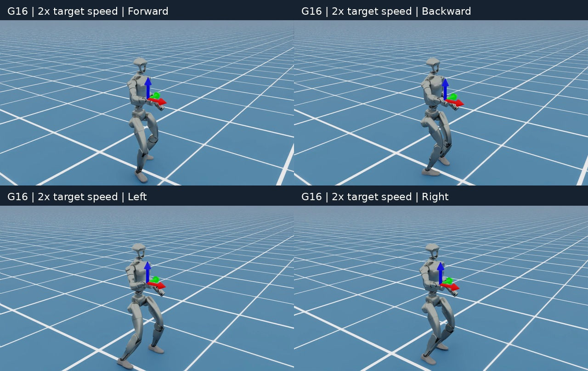
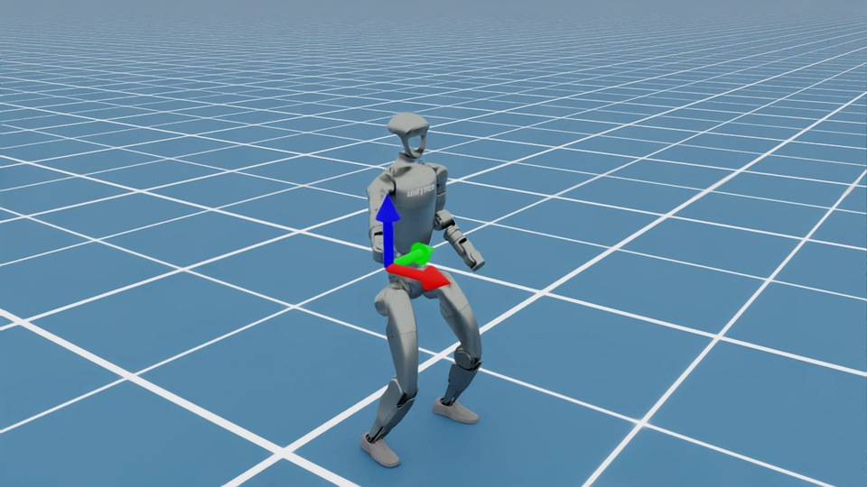

# G16 基线——接入与平移速度评估

[进展摘要](../../REPORT_ZH.md) · [English](2026-11-19_g16_baseline.md)

日期：**2026-11-19**

**状态：四个指定速度的测试均完成，包含最后保持阶段；视频已核验。** 这是后续学习实验的当前参考基线；本次评估没有训练新策略。

站位规划器根据腕部目标和偏好的手臂姿态，求解底盘 XY 位置、偏航角及速度指令。冻结的 **G16** 通过 12 个腿部关节和腰部横滚/俯仰关节执行速度指令。右臂七关节 IK 跟踪世界坐标系中的腕部位姿，并补偿实测身体运动。G16 本身不接收腕部轨迹，也不负责选择站位。

G16 部署适配器保留了模型的关节顺序、观测历史、步态时钟、四元数约定和动作缩放。在 200 步推理对比中，其输出与提供的部署程序完全一致；30 项已有 CPU 测试和两项适配器测试通过。比较行走策略时，腕部规划器、IK 参数和底盘指令限幅保持不变。

*按运动顺序截取的 G16 2× 视频画面。RGB 目标坐标轴表示期望腕部位姿：红色 +X、绿色 +Y、蓝色 +Z。画面来自外部观察视角，不是腕部摄像机拍摄的内容。*

## 评估设置

- 一个仿真 G1，随机种子 42；控制频率 50 Hz，物理仿真频率 200 Hz。
- 依次执行四次 0.50 m 移动：前进（+X）、后退（−X）、左移（+Y）、右移（−Y）。
- 世界坐标系高度在 0.93 至 0.97 m 之间变化；目标姿态保持水平，四元数 xyzw 为 `[0, 0, 0, 1]`。
- 在 1× / 2× / 3× / 4× 速度下，每次移动分别持续 10 / 5 / 3.33 / 2.5 秒；每个方向后停顿 2 秒，路径结束后再保持约 8 秒。
- 目标水平速度峰值分别为 0.094 / 0.188 / 0.281 / 0.375 m/s。底盘指令限幅保持为前进 0.30 m/s、后退 0.25 m/s、侧移 0.22 m/s、偏航 0.35 rad/s。
- 视频分辨率为 1280 × 720，帧率 25 fps，按 **1× 仿真时间**播放；速度倍率指目标运动速度，不是视频加速播放。

## 实测结果

下表误差覆盖完整航点路径及其中的停顿，不包含站立稳定、目标准备和额外的最后保持阶段。身体位置误差以站位规划器给出的期望底盘 XY 位置为参考。

| 目标速度 | 腕部位置 RMS | 腕部姿态 RMS | 底盘 XY 误差 RMS | 录像 |
| --- | ---: | ---: | ---: | --- |
| 1× | 4.05 cm | 8.00° | 4.07 cm | [视频](../../outputs/g1_camera/2026-11-19_g16_four_direction/1x/video.mp4) |
| 2× | 4.25 cm | 8.47° | 5.07 cm | [视频](../../outputs/g1_camera/2026-11-19_g16_four_direction/2x/video.mp4) |
| 3× | 5.85 cm | 10.93° | 7.91 cm | [视频](../../outputs/g1_camera/2026-11-19_g16_four_direction/3x/video.mp4) |
| 4× | 8.47 cm | 8.07° | 13.93 cm | [视频](../../outputs/g1_camera/2026-11-19_g16_four_direction/4x/video.mp4) |

四条路径的统计窗口内，右臂各关节均未进入距软位置限位 0.08 rad 以内的范围。所有 MP4 帧均成功解码，没有全黑帧；覆盖每个方向及最后保持阶段的抽查画面中，机器人和目标坐标轴均可见。

4× 速度下的位置跟踪仍明显变差：虽然运行完成，腕部位置误差峰值达到 **24.05 cm**。目标速度可能超过保持不变的底盘指令限幅，因此完成运行本身不能证明已达到录像所需的跟踪性能。

*4× 视频中接近误差峰值的画面，处于右移阶段：轨迹时间 15.36 s，视频时间约 24.96 s。腕部与目标坐标轴的间距展示了仍然存在的跟踪滞后。*

## 适用范围与复现

这些结果建立了一个适用于平坦、无障碍地面的功能基线。G16 已完成上述单轴姿态扫描，但组合运动测试失败。稳定的通用 6D 跟踪、更广的角度/角速度范围、多随机种子及录像机载荷模型仍未验证。当前尚未建模录像机质量/惯量、抓握、摄像机几何及腕部到摄像机的坐标变换；目标坐标系为 `right_wrist_yaw_link`。该基线不提供全局可达性、避碰或实机可用性保证。

运行脚本默认仍使用仓库自带的 AGILE 策略。选择 G16 需要显式提供 `--checkpoint` 和 `--locomotion-contract`；每次运行的核验文件都包含复现命令，使用该次保存的模型、接口配置和轨迹，并指定新的输出目录。

- [对比数据与分阶段测量](../../outputs/g1_camera/2026-11-19_g16_four_direction/comparison.json)
- [适配器验证](../../outputs/g1_camera/2026-11-19_g16_four_direction/adapter_validation.json)
- 核验与复现：[1×](../../outputs/g1_camera/2026-11-19_g16_four_direction/1x/verification.json)、[2×](../../outputs/g1_camera/2026-11-19_g16_four_direction/2x/verification.json)、[3×](../../outputs/g1_camera/2026-11-19_g16_four_direction/3x/verification.json)、[4×](../../outputs/g1_camera/2026-11-19_g16_four_direction/4x/verification.json)
- [图片来源](../figures/g1_camera_report/sources.json)：仿真录像截图及基于实测跟踪数据绘制的图表；图片副本与本报告一起保存，视频和运行数据保存在 `outputs/` 下。

相关里程碑：[姿态跟踪及组合运动失败记录](2026-11-19_g16_orientation_tracking_zh.md)。
