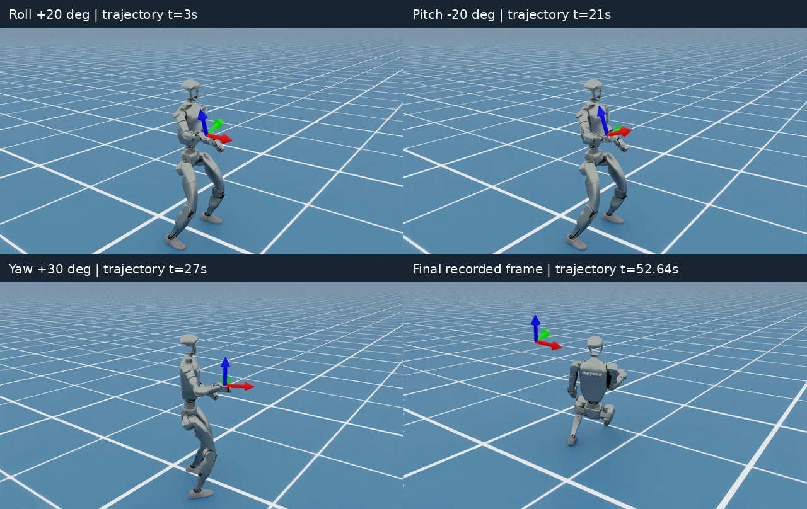
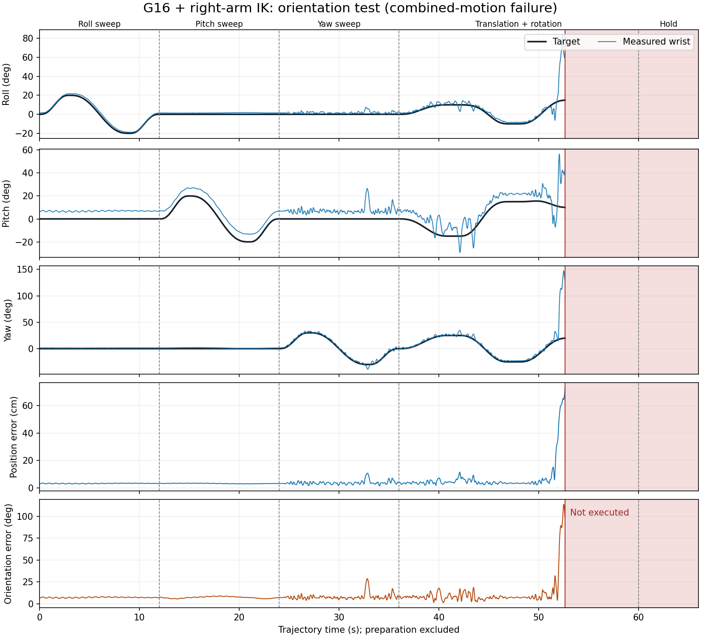

# G16 + IK — orientation tracking evaluation

[Progress summary](../../REPORT.md) · [中文版](2026-11-19_g16_orientation_tracking_zh.md)

Date: **2026-11-19**

Controller architecture, adapter checks, and speed evaluation: [G16 baseline](2026-11-19_g16_baseline.md).

**Isolated orientation sweeps completed; combined walking and rotation failed.** G16, the body planner, IK settings, and command limits were unchanged. This is a newly tested limitation of the baseline, not a full 6D tracking pass.

[Watch orientation-test video](../../outputs/g1_camera/2026-11-19_g16_orientation_tracking/video.mp4) — **62.24 s, 25 fps, 1× simulation time**. Trajectory time zero is video time 9.60 s.

The first 36 s hold wrist XYZ at `[0.70, -0.24, 0.95]` m and sweep roll **±20°**, pitch **±20°**, and yaw **±30°** separately. Body placement remains automatic, so the base can move or turn while wrist position stays fixed. The planned second part combines changing orientation with 0.30 m forward/backward/left/right moves and height 0.93–0.97 m, using smooth quaternion interpolation. See the [exact trajectory](../../outputs/g1_camera/2026-11-19_g16_orientation_tracking/trajectory.json).

*RGB axes show the target orientation. The final panel shows the failure state, not a completed hold.*

| Phase | Measured trajectory time | Status | Position RMS | Orientation RMS |
| --- | --- | --- | ---: | ---: |
| Roll ±20° | 0–12.00 s | Completed | 3.23 cm | 7.17° |
| Pitch ±20° | 12–24.00 s | Completed | 3.20 cm | 7.20° |
| Yaw ±30° | 24–36.00 s | Completed | 4.03 cm | 8.70° |
| Forward + rotation | 36–42.00 s | Completed | 4.26 cm | 8.49° |
| Backward + rotation | 42–48.00 s | Completed | 4.67 cm | 8.45° |
| Left + rotation | 48–52.64 s | Partial; then failed | 25.00 cm | 35.85° |
| Right + rotation | — | Not reached | — | — |
| Final hold | — | Not reached | — | — |

The completed isolated sweeps achieved **3.51 cm position RMS / 7.72° orientation RMS**; yaw still had a **28.71°** peak orientation error. Errors use Euclidean position distance and the shortest relative-rotation angle.

During leftward motion with turning, body heading diverged and pelvis height dropped. At the final logged sample (**52.64 s**), actual base yaw was **111.84°**, planned yaw **19.70°**, and pelvis height **0.473 m**. The next physics step terminated the environment. Rightward motion and the final hold were not reached. The data show locomotion instability; its initiating cause and exact termination term remain unresolved.

*Dashed lines separate planned phases; the red region was not executed. Euler angles are used only for plotting. The failed segment includes all measured instability, with peaks of 73.24 cm and 113.73°.*

The video was fully decoded (1556 frames, no black frames), and the robot and target axes were visually checked. This single failed run and its evidence are retained. Isolated orientation tracking works at the tested angles, but simultaneous walking and turning needs further work; recorder payload and filming quality remain unvalidated.

[Phase measurements](../../outputs/g1_camera/2026-11-19_g16_orientation_tracking/analysis.json) · [Verification and reproduction](../../outputs/g1_camera/2026-11-19_g16_orientation_tracking/verification.json) · [English report](../../outputs/g1_camera/2026-11-19_g16_orientation_tracking/report_en.md) · [中文报告](../../outputs/g1_camera/2026-11-19_g16_orientation_tracking/report_zh.md)

## Scope and reproducibility

These results establish a functional baseline on flat, unobstructed ground. G16 has now completed the isolated orientation sweeps above, but failed the combined-motion test. Stable general 6D tracking, broader angle/rate ranges, multiple seeds, and a modeled recorder payload remain unvalidated. Recorder mass/inertia, grip, camera geometry, and the wrist-to-camera transform remain absent; the target frame is `right_wrist_yaw_link`. There is no global reachability, collision-avoidance, or hardware-readiness guarantee.

The runner still defaults to the bundled AGILE policy. Selecting G16 requires the explicit `--checkpoint` and `--locomotion-contract` options; each run's verification file contains a reproduction command using its saved model, contract, and trajectory, with a new output directory.

[Figure provenance](../figures/g1_camera_report/sources.json).

## Todos

- [ ] Freeze a named G16 baseline configuration and a held-out evaluation set.
- [x] Evaluate isolated roll/pitch/yaw and combined translation/rotation; preserve the observed failure.
- [ ] Diagnose lateral-walking/turning instability and repeat the failed orientation test.
- [ ] Extend to continuous 6D paths, broader orientation/rate ranges, more heights, and multiple seeds.
- [ ] Add recorder mass, inertia, mounting transform, and a simulated recording camera.
- [ ] Define filming-quality limits for pose error, velocity error, jitter/jerk, and captured footage.
- [ ] Reduce high-speed body lag while respecting locomotion and arm limits.
- [ ] Train residual arm/base corrections and compare them with the frozen G16 + IK baseline.
