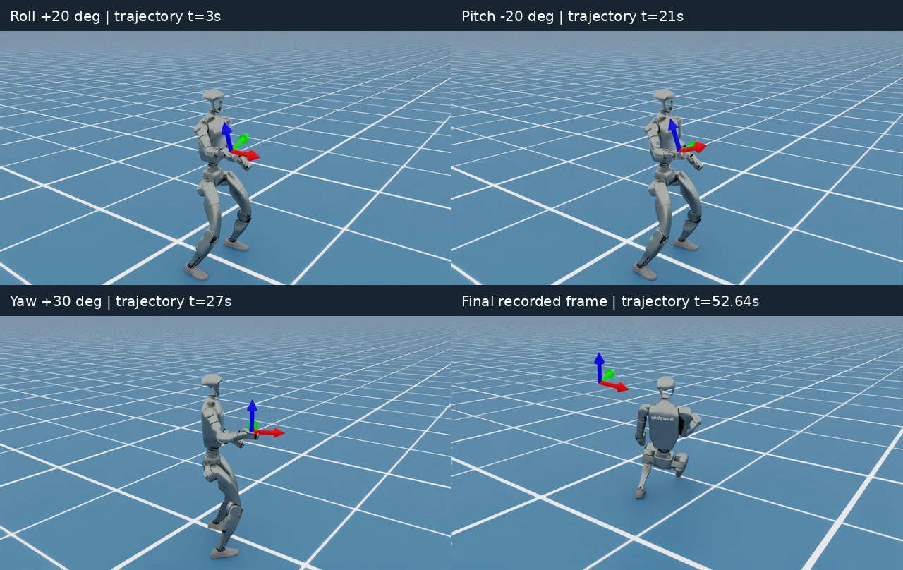
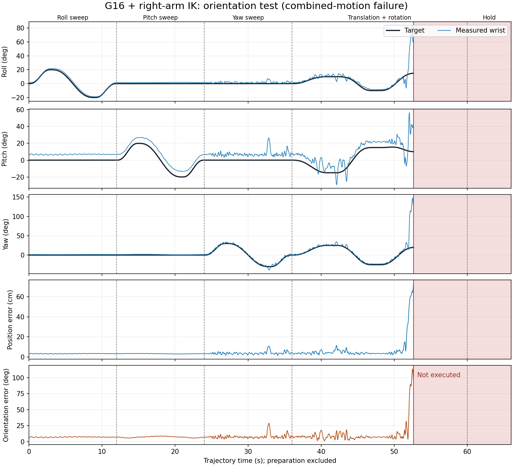

# G16 + IK——姿态跟踪评估

[进展摘要](../../REPORT_ZH.md) · [English](2026-11-19_g16_orientation_tracking.md)

日期：**2026-11-19**

控制器结构、适配器核验和速度评估见 [G16 基线](2026-11-19_g16_baseline_zh.md)。

**单轴姿态扫描完成；行走与旋转组合测试失败。** G16、站位规划器、IK 设置和指令限幅均未改变。本次测试发现了基线的新局限，不能据此认定完整 6D 跟踪已通过验证。

[观看姿态测试视频](../../outputs/g1_camera/2026-11-19_g16_orientation_tracking/video.mp4)——**62.24 s，25 fps，1× 仿真时间**。轨迹零时刻对应视频时间 9.60 s。

前 36 s 将腕部 XYZ 固定在 `[0.70, -0.24, 0.95]` m，分别执行横滚 **±20°**、俯仰 **±20°**、偏航 **±30°** 扫描。站位仍由规划器自动控制，因此腕部位置固定时，底盘可以移动或转向。计划中的第二部分在前、后、左、右各移动 0.30 m 的同时改变姿态，高度在 0.93–0.97 m 之间变化，使用平滑四元数插值。参见[实际目标轨迹](../../outputs/g1_camera/2026-11-19_g16_orientation_tracking/trajectory.json)。

*RGB 坐标轴显示目标姿态。最后一幅图为失败状态，不是完成保持阶段的画面。*

| 阶段 | 已测轨迹时间 | 状态 | 位置 RMS | 姿态 RMS |
| --- | --- | --- | ---: | ---: |
| 横滚 ±20° | 0–12.00 s | 完成 | 3.23 cm | 7.17° |
| 俯仰 ±20° | 12–24.00 s | 完成 | 3.20 cm | 7.20° |
| 偏航 ±30° | 24–36.00 s | 完成 | 4.03 cm | 8.70° |
| 前进 + 旋转 | 36–42.00 s | 完成 | 4.26 cm | 8.49° |
| 后退 + 旋转 | 42–48.00 s | 完成 | 4.67 cm | 8.45° |
| 左移 + 旋转 | 48–52.64 s | 部分完成，随后失败 | 25.00 cm | 35.85° |
| 右移 + 旋转 | — | 未执行 | — | — |
| 最后保持 | — | 未执行 | — | — |

已完成的单轴扫描达到 **3.51 cm 位置 RMS / 7.72° 姿态 RMS**；偏航阶段的姿态误差峰值仍达到 **28.71°**。位置误差采用欧氏距离，姿态误差采用最短相对旋转角。

在左移并转向时，身体朝向偏离目标，骨盆高度下降。最后记录时刻（**52.64 s**），底盘实际偏航为 **111.84°**，规划偏航为 **19.70°**，骨盆高度为 **0.473 m**。下一个物理仿真步触发环境终止，未执行右移和最后保持阶段。数据表明出现了行走失稳，但最初诱因及具体触发的终止项仍未确定。

*虚线分隔计划中的各阶段；红色区域未执行。欧拉角仅用于绘图。失败片段包含全部已测失稳过程，位置和姿态误差峰值分别为 73.24 cm 和 113.73°。*

视频已完整解码（1556 帧，无全黑帧），并检查了机器人和目标坐标轴的可见性。本次失败运行及其证据均已保留。单轴姿态跟踪在所测试角度下能够执行，但同时行走与转向仍需改进；录像机载荷和拍摄画质尚未验证。

[分阶段测量数据](../../outputs/g1_camera/2026-11-19_g16_orientation_tracking/analysis.json) · [核验与复现](../../outputs/g1_camera/2026-11-19_g16_orientation_tracking/verification.json) · [英文实验报告](../../outputs/g1_camera/2026-11-19_g16_orientation_tracking/report_en.md) · [中文实验报告](../../outputs/g1_camera/2026-11-19_g16_orientation_tracking/report_zh.md)

## 适用范围与复现

这些结果建立了一个适用于平坦、无障碍地面的功能基线。G16 已完成上述单轴姿态扫描，但组合运动测试失败。稳定的通用 6D 跟踪、更广的角度/角速度范围、多随机种子及录像机载荷模型仍未验证。当前尚未建模录像机质量/惯量、抓握、摄像机几何及腕部到摄像机的坐标变换；目标坐标系为 `right_wrist_yaw_link`。该基线不提供全局可达性、避碰或实机可用性保证。

运行脚本默认仍使用仓库自带的 AGILE 策略。选择 G16 需要显式提供 `--checkpoint` 和 `--locomotion-contract`；每次运行的核验文件都包含复现命令，使用该次保存的模型、接口配置和轨迹，并指定新的输出目录。

[图片来源](../figures/g1_camera_report/sources.json)。

## 待办事项

- [ ] 定版并命名 G16 基线配置，建立独立评估集。
- [x] 评估单轴横滚/俯仰/偏航及平移/旋转组合运动，保留观测到的失败证据。
- [ ] 定位侧移/转向失稳原因，重新执行失败的姿态测试。
- [ ] 扩展到连续 6D 路径、更广的角度/角速度范围、更多高度和随机种子。
- [ ] 加入录像机质量、惯量、安装坐标变换及仿真摄像机。
- [ ] 定义位姿误差、速度误差、抖动/加加速度及录制画面的质量标准。
- [ ] 在行走和手臂限幅内降低高速运动时的身体跟随滞后。
- [ ] 训练手臂/底盘残差修正策略，与冻结的 G16 + IK 基线比较。
